# Orbital Refuelling Simulator

*Claude Opus 5.5 (max) and DeepSeek V4.1 Flash.*

](https://youtu.be/JuXeH5DBF8w)

A browser game on the last metres of a fictional on-orbit servicing mission. Capture a client
satellite by pushing a probe into its engine nozzle, connect a refuelling arm to its service valve,
transfer propellant and fly away safely. Each challenge lasts one or two minutes, and the motion of
the spacecraft follows simplified but real orbital mechanics, so the game behaves the way an
orbit does.

**Play in the browser:** https://agolkar.github.io/orbitalrefueling/ (a desktop browser with WebGL 2,
the Web Graphics Library; keyboard or gamepad). To run it locally, see [Run](#run).

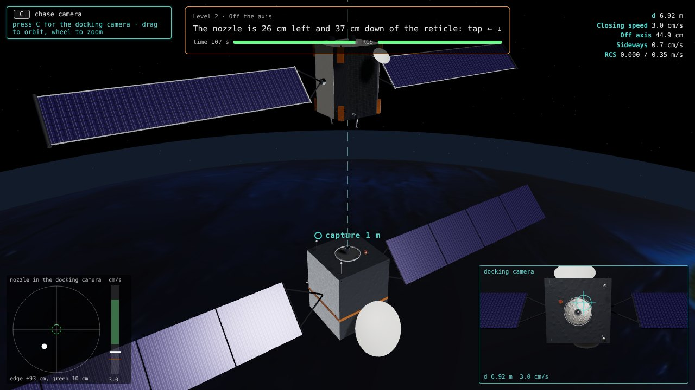

*Level 2 in the Earth observer scenario: the outside view of both spacecraft, the docking camera in
the lower right corner, the docking scope and the closing-speed tape in the lower left corner.*

**AI disclosure.** This game and its documentation were generated with AI. DeepSeek V4.1 Flash,
running locally, wrote the code stage by stage from a specification by the human author, who also
set the game design and reviewed the gameplay. Claude Opus 5.5 (Anthropic) reviewed and corrected
every stage, wrote the capture challenges, the refuelling arm and the docked levels, the fictional
spacecraft models, the music, sound effects and voice callouts and this README, and tested the game
in a headless browser. The voice lines are rendered with the open Kokoro-82M text-to-speech model.
A vision-language model running locally, Qwen3.8-27B, described the reference video for the first
design brief. [How it was made](#how-it-was-made) tells the whole process.

**Fictional spacecraft, no real mission.** The servicer, the client and their mission are
fictional. The game is inspired by a publicly released YouTube video of an on-orbit satellite
servicing mission, which served only as a general reference for the type of mission. The game names
no company, spacecraft or mission, uses no footage, image, logo, livery or graphic from the video,
and its spacecraft and numbers do not represent any real vehicle or its capabilities. The video
showed no propellant transfer: the refuelling in this game is fictional. See the
[Disclaimer](#disclaimer).

## Contents

1. [The game](#the-game)
2. [How it was made](#how-it-was-made)
3. [Physics in brief](#physics-in-brief)
4. [Limitations](#limitations)
5. [Code, tests and running](#code-tests-and-running)
6. [Disclaimer](#disclaimer)
7. [Credits and licence](#credits-and-licence)
8. [Acronyms](#acronyms)

## The game

The game has seven short levels, each playable in three scenarios. Each attempt trains one piloting
or operations skill and gives at most two minutes to fly, operate or plan; the automatic parts
(the probe sequence, the de-spin, the coast to 30 m) follow. Every level has a time limit, the
levels with thrusters a delta-v budget, and the coaching names the keys to press. A success scores
up to 1000 points with one to three stars (three from 750 points, two from 550), a failure scores 0.
The best score of each level and scenario stays in the browser.

### Scenarios

| Scenario | Orbit | Client | The time limit stands for |
|---|---|---|---|
| Retired relay satellite | Graveyard orbit 290 km above the geostationary belt; one orbit lasts 24.2 h | A communications satellite at the end of its life, still holding its attitude | The Sun moving into the docking camera's field of view |
| Earth observer | Circular low Earth orbit at 500 km, 51.6° inclination; one orbit lasts 94.6 min | An Earth observation satellite short of propellant, with a telescope looking at the Earth; the sideways drift is 15 times stronger and the Earth fills the background | The end of the ground-station pass |
| Non-cooperative satellite | Graveyard orbit | An older communications satellite that lost attitude control: its solar wings stopped at different angles, and it spins at 1.2°/s about its engine axis while the axis wobbles 1° every 120 s | The Sun in the docking camera |

### Levels

| Level | Skill | Start | Time | Budget |
|---|---|---|---|---|
| 1 First capture | Close in along the docking axis, slow down, capture | 5 m from the client's ring, at rest | 100 s | 0.30 m/s |
| 2 Off the axis | Centre the nozzle in the reticle while closing in | 7 m, closing at 3 cm/s, 43 cm off the axis and drifting sideways | 110 s | 0.35 m/s |
| 3 Drifting client | Follow a nozzle axis that cones 1.5° every 90 s | 7 m, at rest | 120 s | 0.40 m/s |
| 4 Plume discipline | Brake early: within 2 m of the ring the braking thrusters fire at the client and cost points | 7 m, closing at 12 cm/s | 120 s | 0.30 m/s |
| 5 Connect | Drive the refuelling arm: remove the valve cap, then mate the tool within 5 mm of the valve axis | Docked | 90 s | none (electric arm) |
| 6 Transfer | Leak check, valve sequence, deliver 150 kg within 2 %, close the line | Tool mated | 120 s | none |
| 7 Depart | Plan a separation burn that stays passively safe for two orbits | Docked, pushed off at 2 cm/s | 120 s to plan | 0.20 m/s |

The budgets are delta-v of the servicer's reaction control system (RCS). The non-cooperative
scenario raises every budget by 15 %, because following the wobble costs delta-v.

### How to play

On the menu, choose a scenario with the left and right arrows (or a click) and a level with the up
and down arrows, the number keys or a click; read the brief and press SPACE.

- **Capture (levels 1 to 4).** Hold W to close in and S to brake; hold the arrow keys to move
  sideways as seen in the docking camera. A tap fires the thrusters for at least 0.10 s, a held key
  keeps them firing. Keep the closing speed in the green band of the speed tape (up to 10 cm/s far
  from the client, 2 cm/s at the capture point). When the four capture lights are green (distance,
  axis, speed, alignment and spin), SPACE extends the probe into the nozzle: its fingers open in the
  combustion chamber (soft capture) and the probe pulls the two spacecraft together (hard capture).
  With the non-cooperative satellite, hold U or O to roll until the client stops turning in the
  docking camera; after hard capture the servicer stops the spinning stack in about 9 s.
- **Connect (level 5).** The arrow keys move the tool across the docking axis as seen in the tool
  camera, W lowers it, S raises it, SHIFT slows every motion to a fifth. Touch the cap below 1 cm/s
  and press SPACE to unscrew it; touch the valve below 1 cm/s and press SPACE to mate. Touching the
  ring, the nozzle, a stanchion, the probe or the client deck fails the attempt.
- **Transfer (level 6).** L runs the leak check, 1 2 3 open the valves in order, SPACE starts and
  stops the flow, the up and down arrows set the opening. Deliver 150 kg within 2 %, stop the flow
  and close the valves in reverse order (3, 2, 1). The leak check and the flow run at 30x.
- **Depart (level 7).** The probe pushes the servicer away at 2 cm/s. The up and down arrows add
  along-track velocity to the separation plan, S and W radial velocity, left and right velocity out
  of the orbit plane; Backspace clears the plan. When the two-orbit prediction turns SAFE, SPACE
  executes the burn and the coast to 30 m runs in fast forward (T and G change the speed).

| Key | Action |
|---|---|
| W, S | close in and brake; lower and raise the tool (level 5); radial plan (level 7) |
| Arrow keys | sideways motion; tool motion (level 5); flow opening (level 6); along-track and out-of-plane plan (level 7) |
| U, O | roll (non-cooperative scenario) |
| SPACE | capture; cap and mate (5); start and stop the flow (6); execute the burn (7); start, retry |
| SHIFT | fine motion of the arm |
| L, 1, 2, 3 | leak check and valves (level 6) |
| Backspace, T, G | clear the plan, faster and slower coast (level 7) |
| C | next camera |
| M | orbit plot in the local vertical, local horizontal (LVLH) frame (it opens with level 7) |
| B, V, K | music, voice, all sound on and off |
| Esc | pause and resume; back to the menu from a brief or a result |
| F1, N | help; next level from the result screen |
| A, S | About screen and settings line (on the menu) |

Mouse: buttons are clickable; drag to orbit the outside camera and use the wheel to zoom. A gamepad
with the standard mapping works as the keys it stands for: left stick and d-pad are the arrow keys,
the right stick up and down W and S, the triggers U and O, the shoulders SHIFT, A is SPACE, B and
Start Esc, X C, Y M, Back F1. Level 6 needs the keyboard for L and the valves, level 7 for
Backspace, T and G.

### Cameras and instruments

- **Outside view** (default in the capture levels and in the departure): both spacecraft in view,
  with the docking camera in a window in the lower right corner. C switches to the full docking
  camera, then to a free camera. Connect opens on the tool camera, Transfer on an outside view of
  the arm.
- **Docking camera:** looks along the docking axis, with a reticle, the range and the range rate.
  **Tool camera** (level 5): looks along the tool axis from just above its tip.
- **Feedback line** at the top: one sentence that names the keys to press next, a time bar and an
  RCS bar, and the capture-window lights within 3 m.
- **Docking scope** (lower left): the nozzle's position in the docking camera with a 10 cm green
  circle, and a closing-speed tape whose green band spans 40 % to 100 % of the recommended speed.
  The docked levels draw an arm map and a tool height gauge (level 5), pressure and mass gauges
  (level 6) and a plan rose (level 7) in the same place.
- **LVLH plot** (M): the orbit plane with V-bar (direction of flight) to the right and R-bar down
  toward the Earth. In the capture levels it shows the last metres; in level 7 it shows the 200 m
  keep-out sphere, the trail and the two-orbit prediction.

### Sound

The sound starts with the first key press or click (browsers keep a page silent until then).

- Music: an original dark synth piece in D minor at 92 beats per minute, generated in the browser
  while the game runs (`src/audio/music.js`). One intensity value arranges it: pads and a long bass
  far from the client, the arpeggio and hi-hats closing in, the full beat at the capture point. It
  ducks under the voice and turns muffled in pause.
- Effects: synthesized with the Web Audio API, with no sample files (`src/audio/sfx.js`):
  thrusters, probe motor and latches, arm servos, cap ratchet, valves, propellant flow, beeps,
  chimes and the master caution.
- Voice: a flight computer that speaks only at key moments (`src/audio/director.js`): range at 5, 3
  and 2 m, warnings at most every few seconds, one line per procedure step and the outcome. The 47
  lines are in `src/audio/lines.js`, rendered to `assets/voice/*.mp3` by `tools/make_voice.py` with
  the open Kokoro-82M text-to-speech model (Apache 2.0); the script can render them again with
  another voice.
- B turns the music on and off, V the voice, K all sound. The settings line of the menu also sets
  the volume, the plume brightness (dim, or bright for training) and the corner camera window; the
  choices are kept in the browser.

### Screenshots

<table>
<tr>
<td width="50%">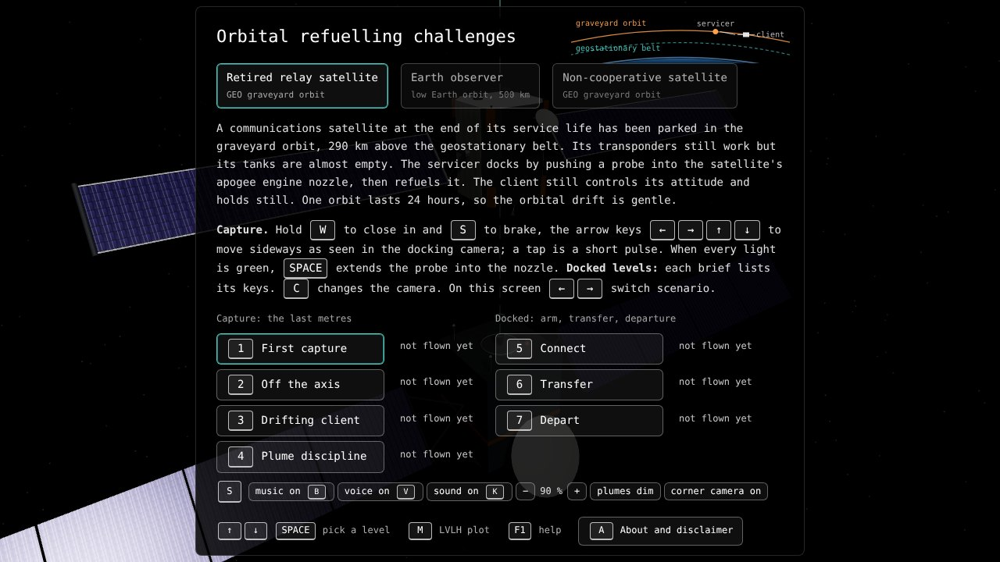<br><em>Menu: three scenarios, seven levels, the settings line and a schematic of the scenario's orbit.</em></td>
<td width="50%">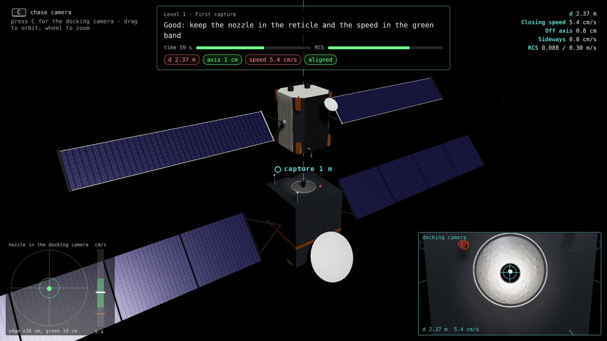<br><em>Level 1 in the graveyard orbit, 2.4 m from the ring, closing at 5.4 cm/s.</em></td>
</tr>
<tr>
<td>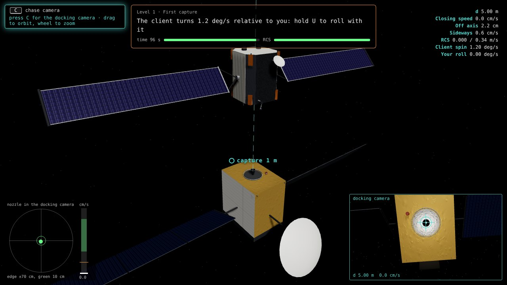<br><em>The non-cooperative satellite: gold bus, a large reflector, wings stopped at different angles.</em></td>
<td>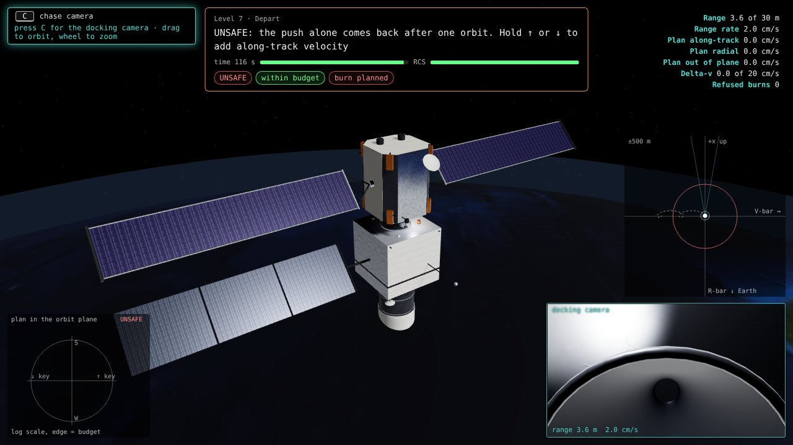<br><em>Level 7 with the Earth observer: the servicer docked on top, the telescope looking at the Earth below.</em></td>
</tr>
<tr>
<td>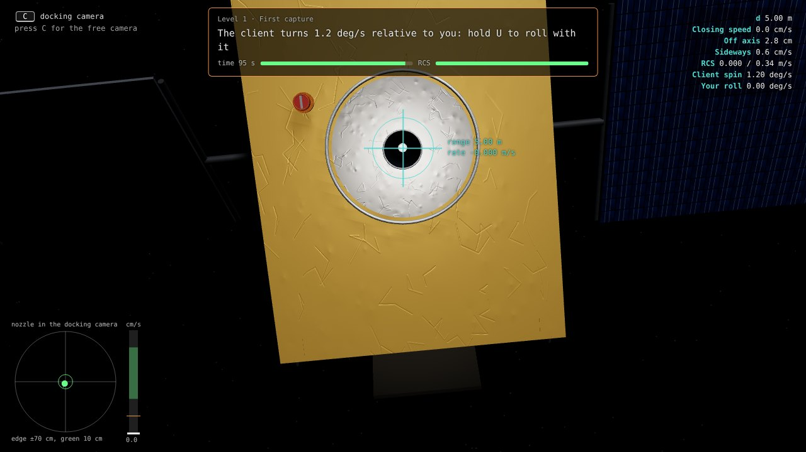<br><em>Docking camera on the non-cooperative satellite: the client turns at 1.2°/s and the pilot must roll with it.</em></td>
<td>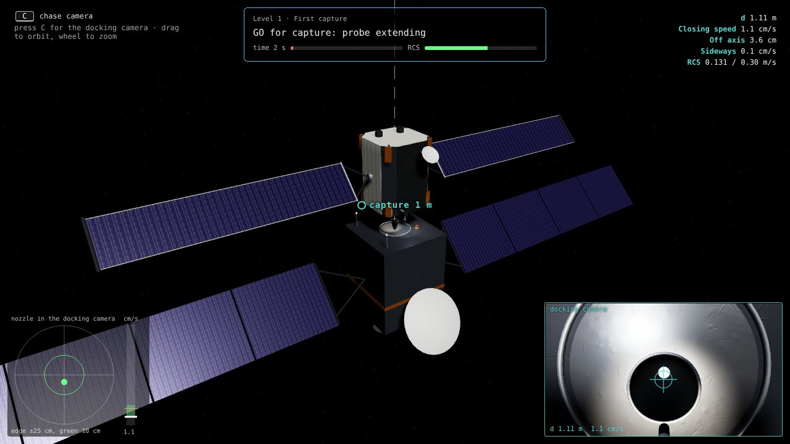<br><em>GO for capture: the probe extends into the apogee engine nozzle (d = 1.11 m, 1.1 cm/s).</em></td>
</tr>
<tr>
<td>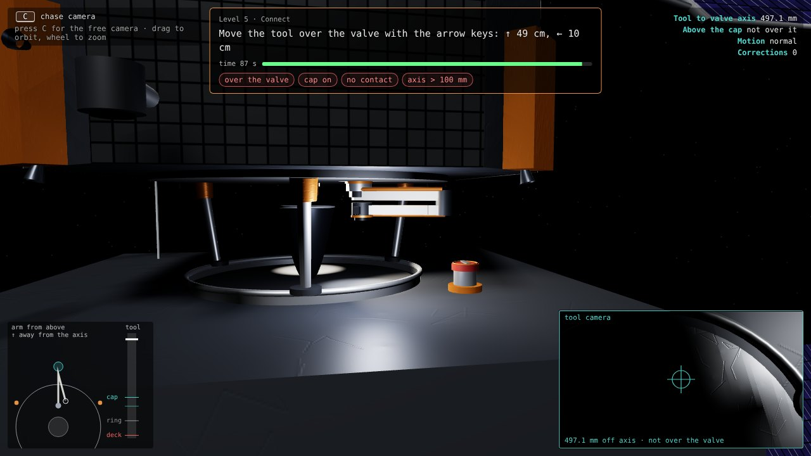<br><em>Level 5: the refuelling arm on the docking plate, the capped service valve on the client's aft face.</em></td>
<td>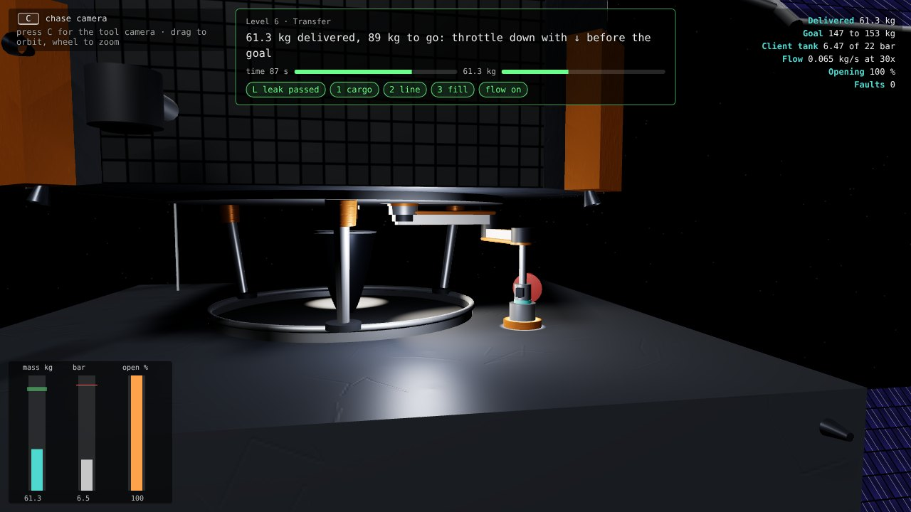<br><em>Level 6: propellant flowing at 30x, with the tank pressures and the delivered mass.</em></td>
</tr>
<tr>
<td>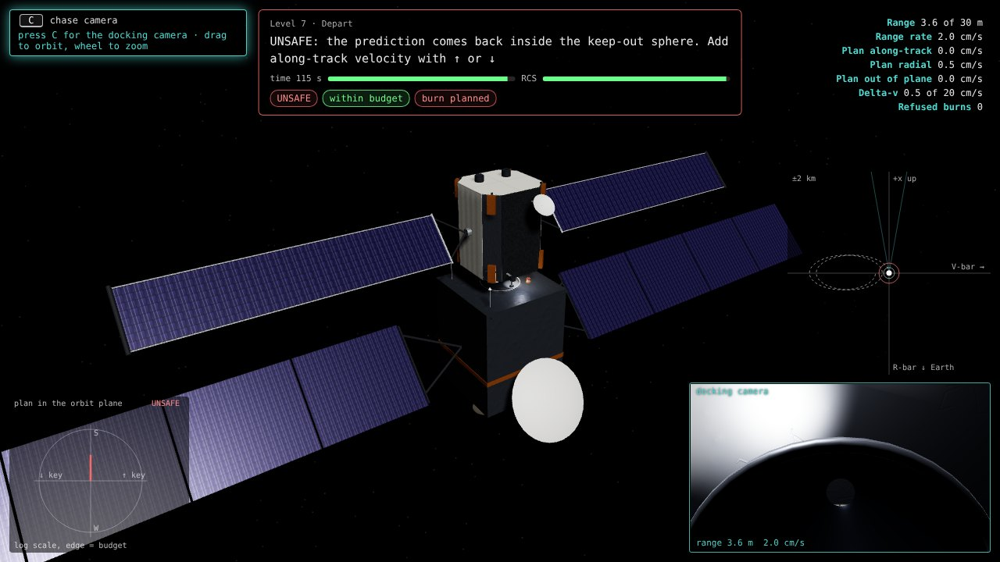<br><em>Level 7, radial burn: the prediction (dashed) closes on itself and comes back into the keep-out sphere. UNSAFE.</em></td>
<td>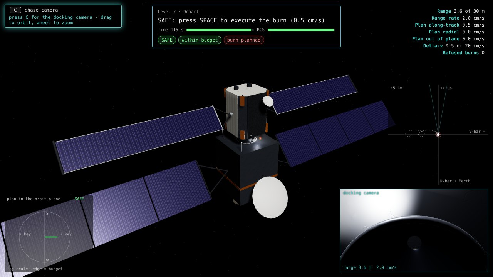<br><em>Level 7, along-track burn of 0.5 cm/s: the servicer drifts away for good. SAFE.</em></td>
</tr>
<tr>
<td>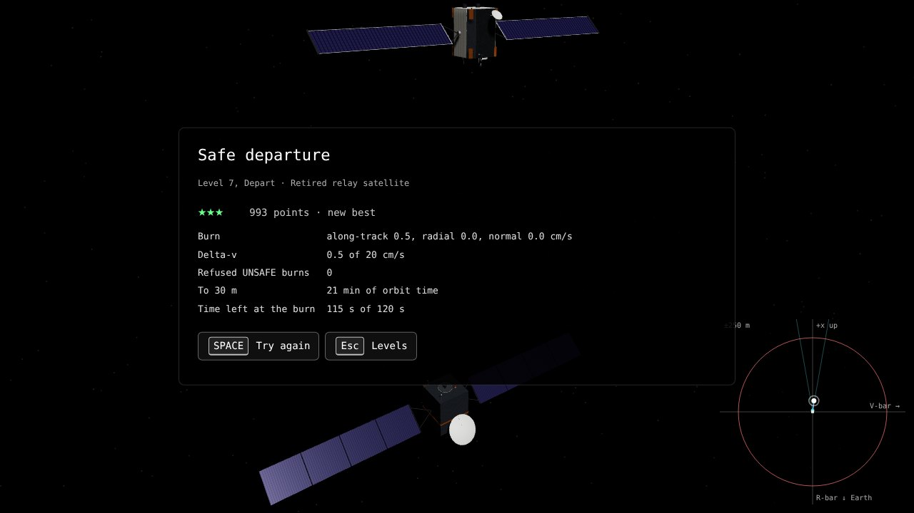<br><em>Result of a departure: score out of 1000, stars and the numbers behind them.</em></td>
<td>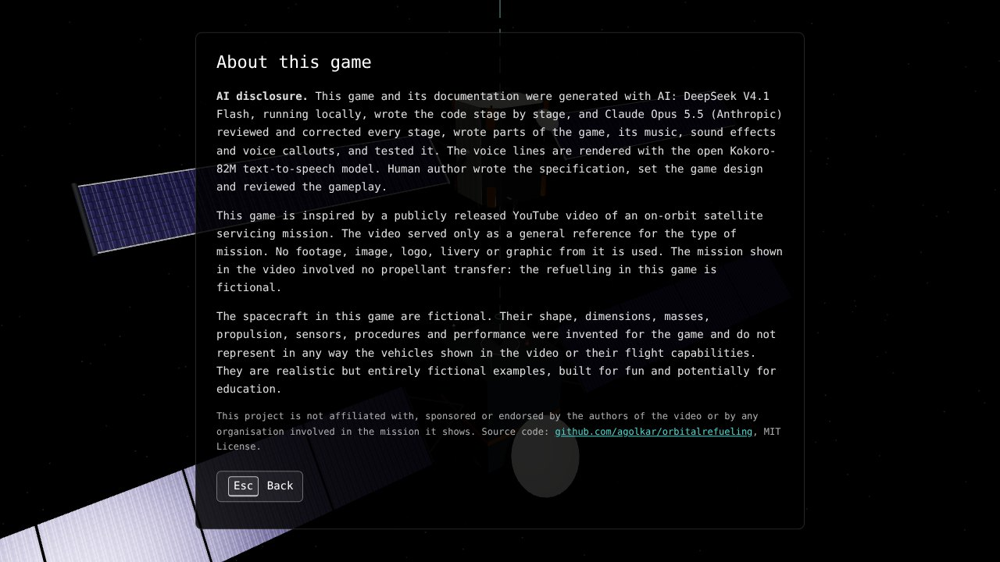<br><em>About screen with the AI disclosure and the disclaimer.</em></td>
</tr>
</table>

## How it was made

The game was built in stages by a coding model running locally on a Mac Studio, with a second model
reviewing every stage and the human author deciding what came next. The process started from a
video and ended with the code in this repository.

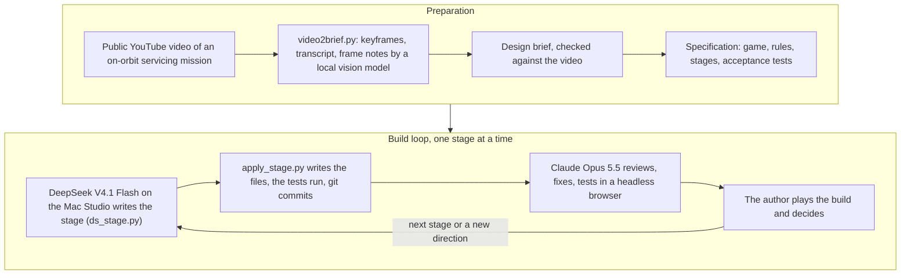

1. **From the video to a brief.** `process/video2brief.py` turns a video file into a written brief:
   ffmpeg extracts keyframes at the scene cuts, a vision-language model running locally
   (Qwen3.8-27B) describes each keyframe, and the same model writes a synthesis. The brief recorded
   the type of mission, the docking hardware, the order of operations and the camera language. It
   describes the video in detail, so it is not published.
2. **From the brief to a specification.** A "master prompt" set the game, the code rules (plain
   JavaScript modules, three.js, no build step, every tunable number in `src/config.js`), the rules
   of play and a staged plan with acceptance tests for each stage. `process/prompt_for_deepseek.md`
   is its last version; the earlier versions carried the brief and are not published.
3. **Staged build.** DeepSeek V4.1 Flash ran on the Mac Studio behind llama-swap, a proxy that
   serves local models through an OpenAI-compatible interface. `process/ds_stage.py` drove it from
   the terminal: it kept the conversation on disk, wrote the files of each answer into the game
   folder through `process/apply_stage.py`, ran the tests and committed the result with git.
4. **Review.** After every stage Claude Opus 5.5 read every file, ran the tests, played the game in
   headless Chrome with scripted key presses and screenshots, fixed what was wrong, added tests and
   wrote notes for DeepSeek's next stage.
5. **Decisions.** The author played every reviewed build and decided the next step.

| Stage | DeepSeek's task | What changed after the review |
|---|---|---|
| 0 | Design review and questions | The answers set the masses, the docking geometry, the arm and valve positions and the time limits |
| 1 | Orbital motion, propellant bookkeeping, 12 tests | Corrections to the Sun direction, the Earth's orientation, the start attitude and the propellant of combined burns |
| 2 | Scene and models | Reviewed together with Stage 1 |
| 3 | Flight: thrusters, plumes, head-up display, orbit plot, time warp, attitude hold | One attitude state in place of two; finer time steps while thrusting |
| 4 | Rules of a full mission from 1 km away | Bugs fixed: a perfect capture scored 195 of 300 points; a phase ended in the step it began; every avoidance manoeuvre ended the mission |
| After 4 | New direction | The game became short challenges of one or two minutes in three scenarios; both spacecraft became fictional vehicles with their own design, and every reference to the real mission was removed |
| 5 | Refuelling and departure | The arm was redesigned so that it reaches the valve with the tool upright; the leak check moved before the valves |
| After 5 | New requests | Outside view as the default camera; music, sound effects and a sparse voice |
| 6 | Gamepad, menu, settings, performance | The gamepad was rewritten so that the pad works as the keys it stands for; the audio was replaced by the new sound |
| After release | New request, made by Claude without DeepSeek | Each scenario got its own client: an Earth observation satellite in low Earth orbit and an older communications satellite for the non-cooperative case, on the same docking interface |

Observations from the build:

- Tests with known expected values caught errors early, and they still run.
- DeepSeek wrote large stages of mostly coherent code. Its typical errors were small and costly: a
  malformed import (`import * * as THREE`) that stopped the whole game, a function that read the
  configuration under the wrong keys, a timer that never reset, a feature wired to the wrong inputs.
  Every stage needed a full review.
- The game became fun once a long, realistic mission turned into short challenges with
  one-sentence feedback that names the keys.

The `process/` folder holds the three scripts and the last specification.

## Physics in brief

The spacecraft move as they would a few metres apart in orbit: the relative motion follows the
Clohessy-Wiltshire equations, the textbook model of two spacecraft flying close together. Orbital
effects show up in play: a sideways drift while you close in, which is fifteen times stronger in
the low orbit than in the high one, and a departure push straight up that brings the servicer back
after one orbit unless a small forward or backward burn sends it away for good. The thrusters have
realistic sizes, burn propellant as they fire, and an automatic attitude control keeps the probe
pointed at the nozzle. The arm, the tank pressures and the propellant flow follow simple models.
Every number and simplification is listed in `ASSUMPTIONS.md`.

## Limitations

The game simplifies on purpose.

- The orbital model leaves out the small disturbances of a real orbit (the Earth's oblateness,
  air drag, sunlight pressure), and the departure check uses the same model it simulates.
- The spacecraft are rigid; the client's spin is scripted; the servicer knows its position exactly.
- Contact, capture, the arm and the propellant line are simple geometric and flow models, with no
  forces or loads.
- Real servicing takes hours or days, with ground teams approving each step. The game compresses
  it into two-minute challenges that start a few metres from the client.
- Space carries no sound: the effects stand for what a crew would hear through the structure.
- Desktop only, no touch controls; a graphics processor is needed. three.js loads from the jsDelivr
  content delivery network (CDN), so the first start needs an internet connection.

## Code, tests and running

### Structure

```
index.html              page, styles, import map
src/config.js           every tunable number, with its units
src/main.js             start-up, frame loop, screens, capture levels
src/dockedPlay.js       docked levels 5 to 7
src/input.js            keyboard and gamepad
src/physics/            orbital motion, vehicle, flight, arm, tank, Sun and Earth
src/game/               level logic and rules
src/render/             scene, spacecraft models, cameras, plumes
src/ui/                 menu, briefs, results, head-up display, plots
src/audio/              music, effects, voice
assets/                 Earth texture (NASA Blue Marble), voice lines
tests/                  77 tests in plain JavaScript
tools/make_voice.py     renders the voice lines with Kokoro-82M
process/                the scripts and the last specification of the build
ASSUMPTIONS.md          every decision and simplification
```

### Tests

```
node tests/run.mjs
deno run --allow-read tests/run.mjs
```

### Run

The game needs no build step. In the project folder:

```
python3 -m http.server 8766
```

then open http://localhost:8766. Any static web server works, and so does GitHub Pages. URL
parameters: `?scenario=geo|leo|tumble` selects a scenario, `?level=1` to `7` opens a level's
brief.

## Disclaimer

This game is inspired by a publicly released YouTube video of an on-orbit satellite servicing
mission. The video served only as a general reference for the type of mission. No footage, image,
logo, livery or graphic from it is used. The mission shown in the video involved no propellant
transfer: the refuelling in this game is fictional.

The spacecraft in this game are fictional. Their shape, dimensions, masses, propulsion, sensors,
procedures and performance were invented for the game and do not represent in any way the vehicles
shown in the video or their flight capabilities. They are realistic but entirely fictional examples,
built for fun and potentially for education. The physical models and numerical values are textbook
approximations and assumptions documented in `ASSUMPTIONS.md`, not data of any real spacecraft or
mission.

This project is not affiliated with, sponsored or endorsed by the authors of the video or by any
organisation involved in the mission it shows. The source code is published at
https://github.com/agolkar/orbitalrefueling under the MIT License (see `LICENSE`).

## Credits and licence

- three.js (MIT License), https://threejs.org
- Voice lines rendered with Kokoro-82M (Apache 2.0) through kokoro-onnx (MIT License).
- Earth texture `assets/earth_day.jpg`: NASA Blue Marble Next Generation, NASA Earth Observatory,
  public domain. Without it the game draws a procedural Earth.
- Models used to make the game: DeepSeek V4.1 Flash and Qwen3.8-27B, running locally; Claude Opus
  5.5 (Anthropic). Tools: ffmpeg, llama-swap, oMLX, Node.js, Playwright.
- Licence: MIT License (`LICENSE`).

## Acronyms

| Acronym | Meaning |
|---|---|
| CDN | Content delivery network |
| GEO | Geostationary Earth orbit |
| LEO | Low Earth orbit |
| LVLH | Local vertical, local horizontal (the frame of the orbit plot) |
| MIT | Massachusetts Institute of Technology (the MIT License takes its name) |
| NASA | National Aeronautics and Space Administration |
| RCS | Reaction control system (the servicer's small thrusters) |
| WebGL | Web Graphics Library (3D graphics in the browser) |
